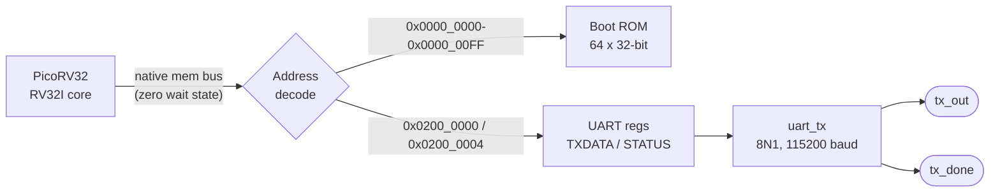

# RISC-V UART SoC on SkyWater 130 nm (OpenLane)

[](https://github.com/MohansaiPotnuru/riscv-uart-sky130-soc/actions/workflows/ci.yml)

A small 32-bit RISC-V system-on-chip, taken from RTL to GDSII with **OpenLane v1** on the open-source **SkyWater SKY130A** PDK. It has:

- a **PicoRV32** RV32I CPU core,
- a **256-byte boot ROM** holding firmware that prints a message,
- a custom **memory-mapped 8N1 UART transmitter** with a busy/status register.

After reset the CPU runs from the ROM and sends `Hello from RISC-V on SKY130!` over `tx_out` at 115200 baud, over and over.

## Architecture



### Memory map

| Address | Name | Access | Description |
|---|---|---|---|
| `0x0000_0000` to `0x0000_00FF` | Boot ROM | R | Firmware. The reset vector is `0x0000_0000`. |
| `0x0200_0000` | `UART_TXDATA` | W / R | Writing `[7:0]` starts a transmission. A read returns the last byte written. |
| `0x0200_0004` | `UART_STATUS` | R | `bit0 = TX_BUSY`. Wait for it to clear before writing the next byte. |
| anything else | – | – | Reads return 0. Writes are ignored. |

### Top-level ports

| Port | Dir | Description |
|---|---|---|
| `clk` | in | System clock, 40 MHz (25 ns) |
| `resetn` | in | Active-low synchronous reset |
| `tx_out` | out | UART TX line (idle high) |
| `tx_done` | out | One-cycle pulse after each stop bit |

### Boot firmware

The firmware is ten RV32I instructions plus the message string. `firmware/gen_rom.py` encodes them straight into `src/boot_rom.v`, so you don't need a RISC-V toolchain. To change the message:

```sh
python3 firmware/gen_rom.py "Custom text\r\n"
```

```asm
        lui   s0, 0x02000        # UART base
restart:addi  s1, zero, MSG
next:   lbu   a0, 0(s1)
        beq   a0, zero, restart
wait:   lw    t0, 4(s0)          # STATUS
        andi  t0, t0, 1
        bne   t0, zero, wait     # spin while TX busy
        sw    a0, 0(s0)          # TXDATA
        addi  s1, s1, 1
        jal   zero, next
```

## Repository layout

```text
riscv-uart-sky130-soc/
├── src/
│   ├── riscv_uart_soc.v     # Top level: address decode, UART registers, CPU + ROM + UART
│   ├── uart_tx.v            # 8N1 UART transmitter (start/data/stop FSM, busy + done flags)
│   ├── boot_rom.v           # Generated boot ROM (do not edit by hand)
│   └── picorv32.v           # PicoRV32 core by Claire Wolf / YosysHQ (ISC licence, unmodified)
├── tb/
│   └── tb_riscv_uart_soc.v  # Self-checking testbench with a UART receiver model
├── firmware/
│   └── gen_rom.py           # RV32I encoder + ROM generator
├── config.json              # OpenLane design configuration
├── Makefile                 # sim / wave / lint / synth helpers
└── .github/workflows/ci.yml # Runs the simulation and a Yosys synthesis on every push
```

## Design parameters (OpenLane)

| Parameter | Value |
|---|---|
| PDK / standard cells | `sky130A` / `sky130_fd_sc_hd` |
| Clock | 25 ns (40 MHz) on `clk` |
| Die area | 500 µm × 500 µm (absolute sizing) |
| Placement density | 0.50 |
| PDN | Core ring enabled, design hardened as a core |
| UART | 115200 baud, `CLKS_PER_BIT = 40 MHz / 115200 = 347` |
| CPU options | No counters, no barrel shifter, no MUL/DIV, no compressed ISA (to save area) |

If you change `CLOCK_PERIOD` in `config.json`, change the `CLK_FREQ_HZ` parameter in `riscv_uart_soc.v` to match, or the baud rate will be off.

## Simulation

You need [Icarus Verilog](https://steveicarus.github.io/iverilog/) 11 or newer. [Yosys](https://github.com/YosysHQ/yosys) is optional and only used for `make synth`.

```sh
make sim      # build and run the self-checking testbench
make wave     # same, plus a VCD dump for GTKWave
make synth    # generic Yosys synthesis + cell statistics
make lint     # Verilator lint (optional)
```

The testbench uses a smaller clock-to-baud ratio (10 clocks per bit) so it runs fast. It decodes the UART output and passes only if the full message arrives correctly twice:

```text
UART: Hello from RISC-V on SKY130!<0d><0a>Hello from RISC-V on SKY130!<0d><0a>
PASS: received 60 bytes correctly
```

## Running the OpenLane flow

You need Docker and an [OpenLane v1](https://github.com/The-OpenROAD-Project/OpenLane) checkout with the sky130A PDK installed (`make` inside the OpenLane directory does this).

```sh
# 1. Copy this design into OpenLane's designs directory
cp -r riscv-uart-sky130-soc  ~/OpenLane/designs/riscv_uart_soc

# 2. Start the OpenLane container and run the full RTL-to-GDSII flow
cd ~/OpenLane
make mount
./flow.tcl -design riscv_uart_soc -tag run1 -overwrite
```

The results go to `designs/riscv_uart_soc/runs/run1/`. The final GDS is in `results/final/gds/` and the signoff reports are in `reports/signoff/`.

## Physical design results

I ran the earlier revision of this design (same CPU, UART and floorplan, but no boot ROM) through the complete OpenLane flow: Yosys synthesis, floorplan and PDN, placement, CTS, global/detailed routing, then Magic/KLayout signoff. The final report said:

```text
[INFO]: No DRC violations after detailed routing.
[INFO]: No DRC violations after GDS streaming out.
[INFO]: There are no setup violations in the design at the typical corner.
[INFO]: There are no hold violations in the design at the typical corner.
[SUCCESS]: Flow complete.
```

LVS also passed. The current revision adds a 64-word combinational ROM, a UART status register and the corrected baud divisor. Re-run the flow to get updated area and timing numbers before quoting them.

> Note: this is a hardened layout (GDSII) produced by an open-source flow. It has not been fabricated.

## Changelog

- **v2** – Added a boot ROM so the CPU has code to run. In v1 every fetch returned `0x00000000`, an illegal instruction. Also added the `UART_STATUS` busy register, fixed the baud divisor (it was 87, which gives about 460 kbaud at 40 MHz; it is now derived from `CLK_FREQ_HZ / BAUD_RATE`), made `tx_done` a single-cycle pulse, made the UART reset synchronous to match the rest of the design, moved sources into `src/` to match `config.json`, and added the testbench and CI.
- **v1** – Initial PicoRV32 + UART integration, hardened with OpenLane.

## Acknowledgements and licences

- **PicoRV32** © Claire Xenia Wolf, ISC licence (see the header of `src/picorv32.v`).
- **SkyWater SKY130 PDK** – open-source PDK by Google and SkyWater Technology.
- **OpenLane / OpenROAD** – open-source RTL-to-GDSII flow by Efabless and the OpenROAD project.
